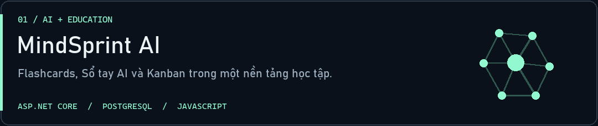
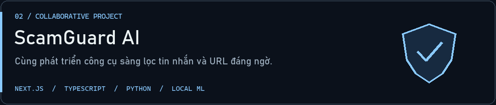
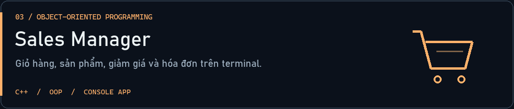
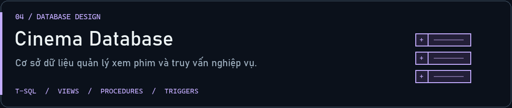
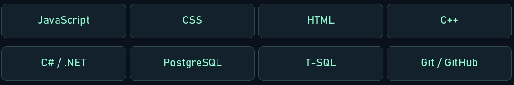

  

  <a href="#ve-minh">Về mình</a> ·
  <a href="#du-an">Dự án</a> ·
  <a href="https://github.com/tungtungsahul?tab=repositories">Tất cả repository ↗</a>

## Chào, mình là Duy 👋

Mình thích biến những gì đang học thành dự án có thể chạy được — từ **C++**, **cơ sở dữ liệu** đến **ứng dụng web tích hợp AI**. Đây là góc nhỏ để mình lưu lại quá trình thử, sửa và hiểu thêm mỗi ngày.

Hiện mình đang phát triển **[MindSprint AI](https://github.com/tungtungsahul/MindSprint-AI-D-n)**: kết hợp flashcards, Sổ tay AI và quản lý công việc để hỗ trợ việc học. Mình cũng **cùng phát triển [ScamGuard AI](https://github.com/maingiangu-svg/ScamGuard-AI)** với nhóm: sàng lọc tin nhắn và URL đáng ngờ bằng mô hình học máy chạy cục bộ.

## Những thứ mình đang xây

## Công nghệ trong các dự án

---

  <b>build. learn. repeat.</b> 
  Mỗi dự án là một lần hiểu thêm. · <a href="assets/hero.png">Xem banner tĩnh</a>

