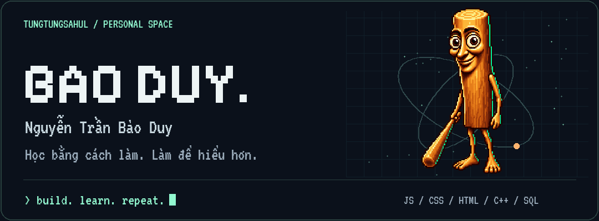
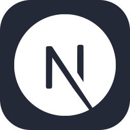
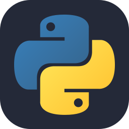
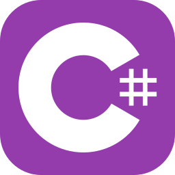
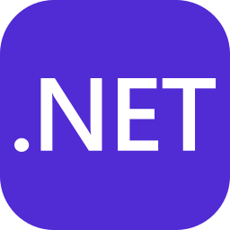
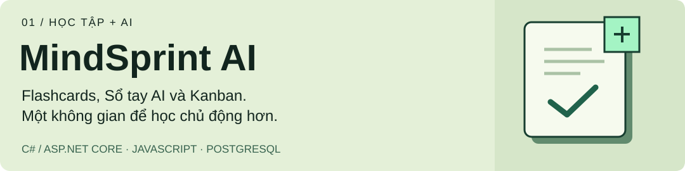
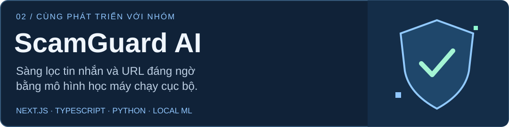

  

  

  Mình học qua những dự án có thể chạy được: 
  <b>ứng dụng web, AI, C++ và cơ sở dữ liệu.</b> 
  Thử một ý tưởng, sửa từng chút và hiểu thêm mỗi ngày.

  <a href="#cong-nghe">Công nghệ</a> &nbsp; / &nbsp;
  <a href="#du-an">Dự án</a> &nbsp; / &nbsp;
  <a href="#hoat-dong">Hoạt động</a>

<h2>Công nghệ trong các dự án</h2>

     

JavaScript · HTML · CSS · TypeScript · React · Next.js

     

Python · C++ · C# · .NET · PostgreSQL · Git

Cơ sở dữ liệu: PostgreSQL và T-SQL / SQL Server.

<h2>Dự án nổi bật</h2>

<b>Đang phát triển.</b> Kết hợp công cụ ôn tập, ghi chép và quản lý công việc để hỗ trợ việc học. <a href="https://github.com/tungtungsahul/MindSprint-AI-D-n">Khám phá dự án ↗</a>

<b>Cùng phát triển với nhóm.</b> Xây dựng công cụ hỗ trợ nhận diện dấu hiệu đáng ngờ trong tin nhắn và URL. <a href="https://github.com/maingiangu-svg/ScamGuard-AI">Xem repository của nhóm ↗</a>

<table>
  <tr>
    <td width="50%" valign="top">
      <h3>Sales Manager</h3>
      
Giỏ hàng, sản phẩm vật lý và sản phẩm số, giảm giá và in hóa đơn trên terminal.

      
<code>C++</code> <code>OOP</code>

      <a href="https://github.com/tungtungsahul/Sales_manager">Xem mã nguồn ↗</a>
    </td>
    <td width="50%" valign="top">
      <h3>Cinema Database</h3>
      
Cơ sở dữ liệu quản lý xem phim, truy vấn nghiệp vụ, views, procedures và triggers.

      
<code>T-SQL</code> <code>SQL Server</code>

      <a href="https://github.com/tungtungsahul/CSDL_Project">Xem mã nguồn ↗</a>
    </td>
  </tr>
</table>

<a href="https://github.com/tungtungsahul?tab=repositories">Xem tất cả repository ↗</a>

<h2>Mỗi ô xanh là một chút tiến bộ</h2>

<picture>
  <source media="(prefers-color-scheme: dark)" srcset="assets/contributions-dark.svg" />
  <source media="(prefers-color-scheme: light)" srcset="assets/contributions.svg" />
  
</picture>

Biểu đồ đóng góp GitHub, với một chút tinh nghịch.

  <b>build. learn. repeat.</b> 
  Mỗi dự án là một lần hiểu thêm. 
  <a href="assets/hero.png">Banner tĩnh</a> · <a href="THIRD_PARTY.md">Công cụ &amp; nguồn thiết kế</a>

